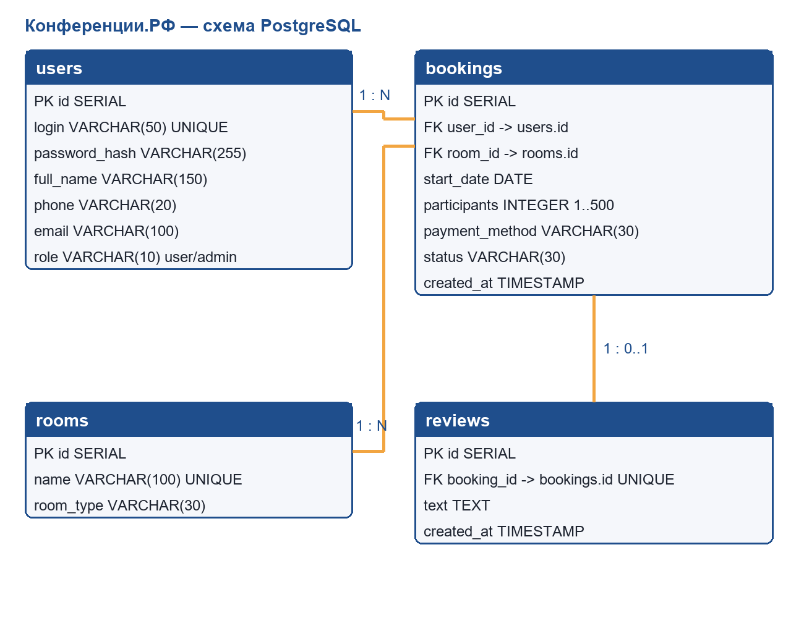

# Конференции.РФ

Учебное веб-приложение для бронирования аудиторий, коворкингов и кинозалов. Подготовлено по заданию Модуля 1: «Проектирование и разработка информационных систем».

Автор: Самойлов Артем Сергеевич, группа 4ИСП9-45.

## Возможности

- Регистрация с проверкой логина, пароля, ФИО, телефона и email.
- Вход пользователя и администратора, разграничение доступа.
- Создание и просмотр собственных заявок.
- Смена статуса, фильтрация заявок по статусу и помещению в панели администратора.
- Удаление новой заявки владельцем; удаление заявки администратором.
- Один отзыв на заявку после завершения мероприятия.
- Проверка количества участников: целое число от 1 до 500.

Вариант Модуля 1 использует кнопку «Создать пользователя», текстовое название помещения и текстовую дату `ДД.ММ.ГГГГ`. Названия помещений распознаются без учёта регистра, в том числе для кириллицы.

## Технологии

Python 3, Flask, PostgreSQL, HTML5, Jinja2, CSS3, JavaScript и локальный Bootstrap 5.3.8. Пароли хранятся в виде хешей Werkzeug. SQL-запросы используют параметры.

## Получение проекта

Репозиторий: https://github.com/Lipson07/conferences-rf-module-1

```bash
git clone https://github.com/Lipson07/conferences-rf-module-1.git
cd conferences-rf-module-1
```

## Запуск

Нужны Python 3.12 или совместимая версия и установленный PostgreSQL. Создайте **новую** базу и отдельную роль из административной консоли PostgreSQL:

```sql
CREATE USER conf_user WITH PASSWORD 'conf_pass';
CREATE DATABASE conferences OWNER conf_user;
```

`conf_pass` — демонстрационный пароль учебной базы. Для своей среды можно задать другой пароль через переменные окружения ниже.

### Windows PowerShell

В папке проекта:

```powershell
python -m venv venv
.\venv\Scripts\Activate.ps1
python -m pip install -r requirements.txt
psql -h localhost -U conf_user -d conferences -f schema.sql
python create_admin.py
python app.py
```

### Linux и ROSA

```bash
python3 -m venv venv
source venv/bin/activate
python -m pip install -r requirements.txt
psql -h localhost -U conf_user -d conferences -f schema.sql
python create_admin.py
python app.py
```

Откройте [http://127.0.0.1:5000](http://127.0.0.1:5000). Учебная учётная запись администратора из задания: логин `Conf2027`, пароль `Demo77`. Обычного пользователя создайте через страницу регистрации.

Если на учебном компьютере нет сети, зависимости можно установить из заранее подготовленной папки пакетов для соответствующей ОС и версии Python:

```bash
python -m pip install --no-index --find-links /путь/к/wheels -r requirements.txt
```

Bootstrap, CSS, JavaScript и SVG-иллюстрации уже включены в проект: для их загрузки сайту не нужен интернет.

## Настройки

`config.py` читает переменные окружения:

| Переменная | Значение по умолчанию |
| --- | --- |
| `PGHOST` | `localhost` |
| `PGPORT` | `5432` |
| `PGDATABASE` | `conferences` |
| `PGUSER` | `conf_user` |
| `PGPASSWORD` | демонстрационный пароль `conf_pass` |
| `SECRET_KEY` | случайный ключ при каждом запуске |

Чтобы сессии сохранялись после перезапуска приложения, задайте свой постоянный случайный `SECRET_KEY` в окружении. Настройки можно задать перед запуском, например в PowerShell:

```powershell
$env:PGPORT = '5432'
$env:PGPASSWORD = '<пароль вашей учебной роли>'
$env:SECRET_KEY = '<ваша случайная строка>'
python app.py
```

В Linux используйте `export ИМЯ=значение`. Файл `.env` приложение автоматически не загружает. Реальные пароли и ключи не следует включать в Git.

`schema.sql` создаёт четыре таблицы и справочник помещений без удаления существующих данных. Скрипт предназначен для новой базы; он не заменяет миграции базы другой структуры.

## Структура

| Файл или папка | Назначение |
| --- | --- |
| `app.py` | маршруты Flask и контроль доступа |
| `db.py` | соединения PostgreSQL и транзакции |
| `repositories.py` | классы пользователей, помещений, заявок и отзывов |
| `validators.py` | серверная проверка регистрации и даты |
| `schema.sql` | таблицы, ограничения, связи и справочник |
| `create_admin.py` | создание учебного администратора |
| `er_diagram.png`, `er_diagram.mmd` | диаграмма базы и её исходник |
| `templates/` | шесть страниц и общий шаблон |
| `static/` | стили, сценарии, иллюстрации и Bootstrap |
| `practice/` | примеры JavaScript, SQL и классов Python |
| `tests/integration.py` | интеграционная проверка на отдельном тестовом кластере |



## Проверки

При первоначальной локальной проверке выполнены:

- **45 интеграционных проверок** через Flask test client и прямые запросы к PostgreSQL 18.4: регистрация, вход, роли, сохранение заявок, ошибки полей, фильтры, статусы, отзывы, удаление, внешние ключи и загрузка локальных ресурсов.
- **10 проверок регулярных выражений** из учебной практики JavaScript.
- Проверка синтаксиса JavaScript, компиляция Python и запуск примера классов `Booking` и `Room`.
- Визуальный просмотр HTML-снимков всех шести страниц при размере **390 × 844** без горизонтального переполнения. Отправка форм проверялась интеграционно; действиями в браузере формы не отправлялись.

Использовался отдельный временный кластер PostgreSQL на `127.0.0.1:55446`. После проверки он был остановлен. Существующие пользовательские базы не использовались.

Для повторения интеграционного теста запустите отдельный тестовый кластер PostgreSQL и задайте `PGHOST`, `PGPORT`, `PGUSER`, при необходимости `PGPASSWORD`. Тестовой роли нужны права `CREATEDB`; тест создаёт новую базу со случайным именем и не удаляет существующие базы. Затем:

```bash
python tests/integration.py
```

Результаты и HTML-снимки создаются локально; файлы отчётов проверки исключены из Git. Отдельный проектный сервер тест сам не запускает.

## История и объём работы

Первоначальная реализация подготовлена на Windows и сохранена пятью последовательными локальными Git-коммитами: зависимости, схема базы и ER-диаграмма, серверная логика, страницы и стили, проверки и инструкции. На этом первоначальном этапе внешняя отправка не выполнялась. Авторы и история этих коммитов сохранены.

Этап установки ROSA Linux был пропущен по разрешению в задании для другой ОС. ER-диаграмма построена по SQL; SVG-иллюстрации созданы кодом. Обработка фотографий в GIMP и файлы XCF относятся к отдельному Модулю 2.

## Документация зависимостей

- [Flask: тестирование приложений](https://flask.palletsprojects.com/en/stable/testing/)
- [Bootstrap: загрузка локальных файлов](https://getbootstrap.com/docs/5.3/getting-started/download/)

Лицензия включённого Bootstrap находится в `static/vendor/bootstrap/LICENSE`.
